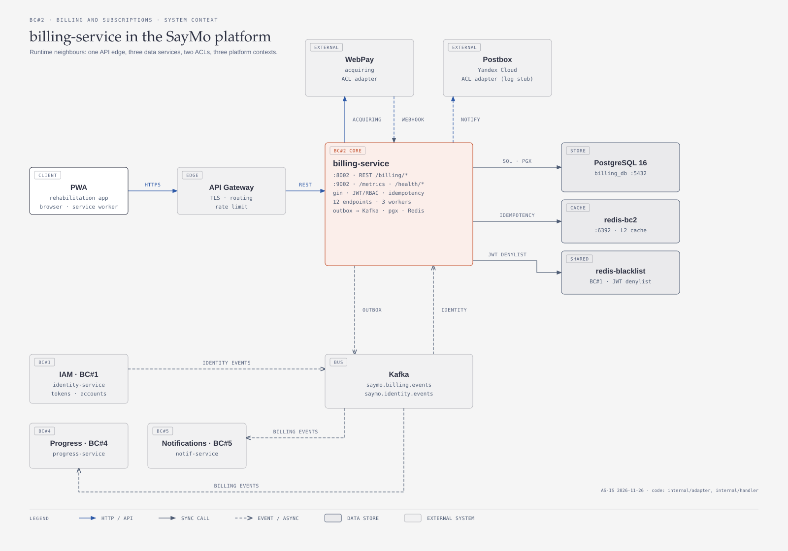
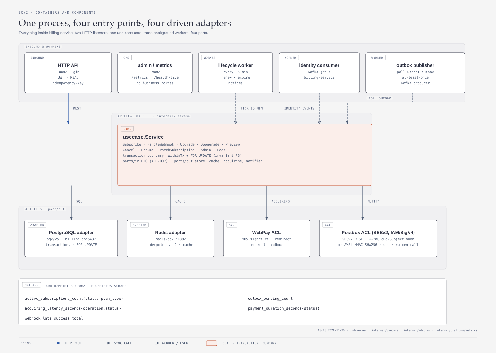
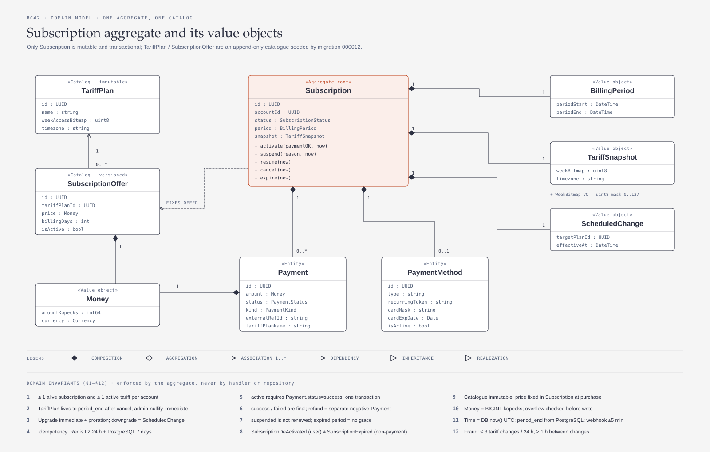
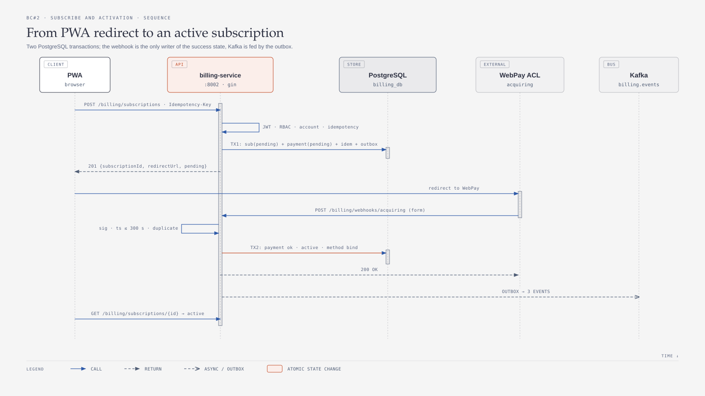
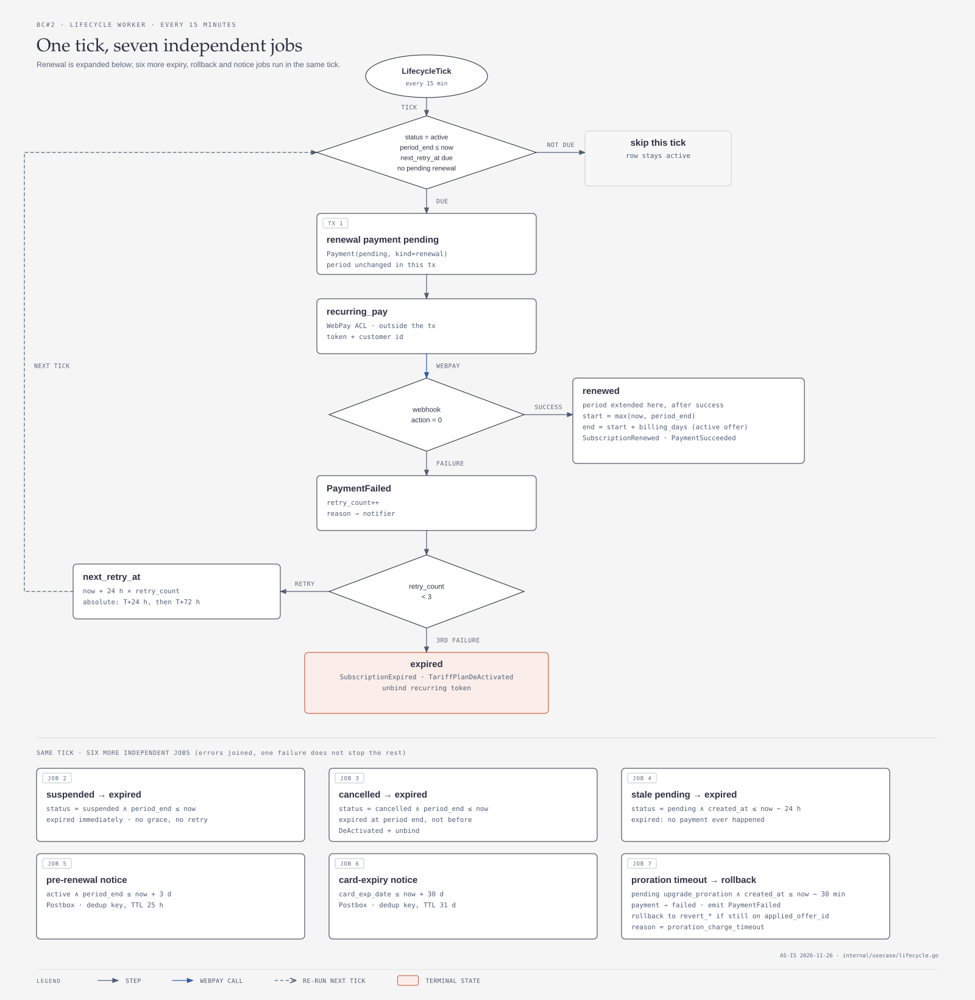
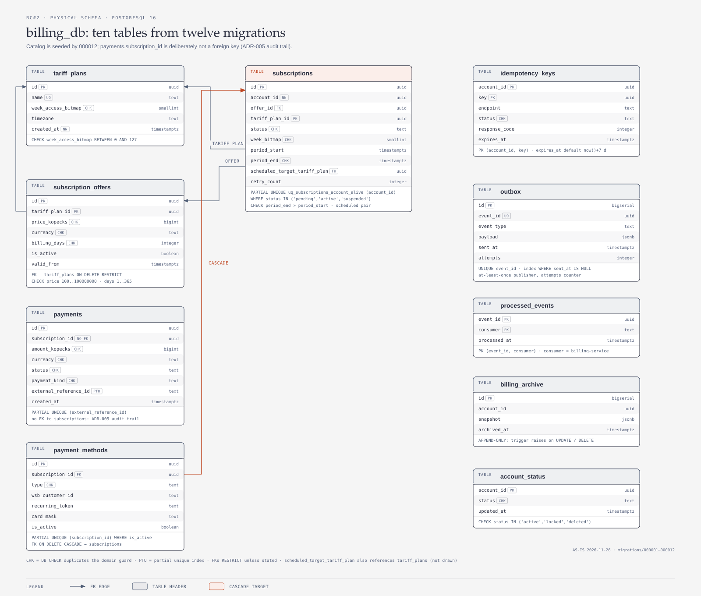
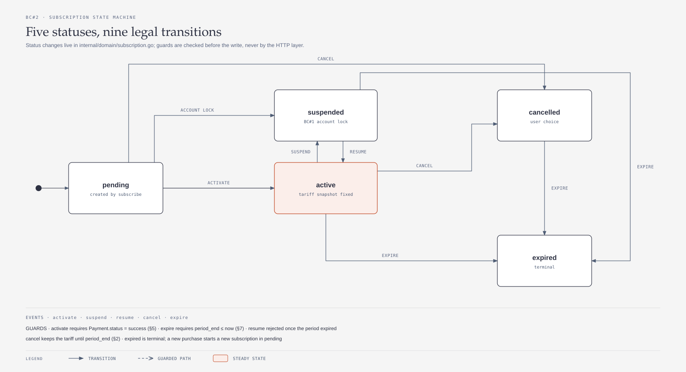

# billing-service — BC#2 Billing and Subscriptions Management

Сервис платформы SayMo (PWA реабилитации после инсульта). Отвечает за тарифные планы,
подписки, платежи и интеграцию с эквайрингом WebPay через Anticorruption Layer.

**PACELC: PC/EC** — активация тарифа и списание атомарны; читается актуальный тариф,
двойные активации запрещены.

Источники контрактов: `Reddetk/saymo-documentation` — `classifications/BillingandSubscriptionsManagement.md`,
`endpoints.md#bc2`, `events.md#bc2`, `EventDataFlow.md`, `agrigats.md#bc2`, `glossary.md`,
`Observability.md#bc2`, ADR-005, ADR-007, ADR-010.

---

## Ubiquitous Language

| Термин | Определение |
|--------|-------------|
| TariffPlan | Шаблон доступа: 7-битная маска дней недели (`weekBitmap`), когда BC#4 может открывать урок |
| SubscriptionOffer | Ценовое предложение: связывает TariffPlan с ценой и периодом; версионируется `validFrom`/`validUntil` |
| Subscription | Договор аккаунта: фиксирует оффер и цену на момент покупки |
| ActiveSubscription | Текущая подписка аккаунта; максимум одна |
| ActiveTariffPlan | Активный доступ к контенту по правилам TariffPlan |
| BillingPeriod | Расчётный период `{periodStart, periodEnd}`; конец периода считает PostgreSQL |
| Payment | Запись о транзакции: сумма в копейках, статус, ссылка на транзакцию эквайринга |
| Acquiring | Внешний платёжный процессор (WebPay) за ACL |
| Proration | Перерасчёт при upgrade внутри периода |
| ScheduledChange | Отложенный downgrade на следующий период |
| SuspendedSubscription | Подписка приостановлена из-за блокировки аккаунта |
| IdempotencyKey | UUID-ключ защиты от повторного списания |

---

## Гарантии (Bounded Context Invariants)

### 1. Уникальность

- У аккаунта максимум одна `ActiveSubscription` и один `ActiveTariffPlan`.
- Новая подписка невозможна при существующей живой (`pending`, `active`, `suspended`).
- `ActiveTariffPlan` не существует без подписки или явной admin-активации.

### 2. Жизненный цикл тарифа

- Тариф остаётся активным до конца `BillingPeriod`, даже если подписка отменена.
- После `periodEnd` без продления публикуется `TariffPlanDeActivated`.
- `Suspended` сохраняет тариф до конца периода.
- Admin-nullify деактивирует тариф немедленно.

### 3. Смена тарифа

- **Upgrade** действует немедленно, списывается proration за оставшиеся дни; период не меняется.
- **Downgrade** действует со следующего периода через `ScheduledChange`.
- Обе операции сериализуются pessimistic lock на подписке; конкурентный upgrade не списывает дважды.

### 4. Идемпотентность платежей

- Каждый платёжный запрос имеет UUID `Idempotency-Key`; повтор возвращает результат первого запроса.
- Ключ хранится в Redis L2 (24 ч) и PostgreSQL (7 дней).
- Статусы `success` и `failed` финальны.

### 5. Payment → Subscription

- `Payment` создаётся до вызова acquiring (`status=pending`).
- Активация подписки и успешный платёж — одна транзакция.
- При неуспешном платеже подписка остаётся `pending`.

### 6. Связность платежа и подписки

- Подписка не переходит в `active` без `Payment.status=success`.
- `Payment.status=success` неизменяем (no UPDATE статуса, no DELETE).
- Refund создаёт отдельную запись с отрицательной суммой, оригинал не меняется.

### 7. Suspended

- `Suspended` не продлевается.
- `AccountUnlocked` возобновляет подписку, если период не истёк.
- Если период истёк в suspended — `SubscriptionExpired` без grace.

### 8. Семантика деактивации

- `SubscriptionDeActivated` — отмена пользователем; доступ живёт до `periodEnd`, затем `TariffPlanDeActivated`.
- `SubscriptionExpired` — истечение периода без оплаты; `SubscriptionExpired` + `TariffPlanDeActivated` одновременно.

### 9. Каталог

- `TariffPlan` иммутабелен после создания.
- Оффер можно снять с продажи; существующие подписки продолжают работать.
- Новая цена — новый оффер с новым `validFrom`; цена подписки не меняется до renewal.
- При renewal используется актуальный активный оффер того же тарифа.

### 10. Деньги

- Все суммы — BIGINT в копейках.
- `priceKopecks` ∈ [100, 100 000 000]; `amountKopecks` ∈ [1, 100 000 000].
- `billingDays` ∈ [1, 365]; `weekBitmap` ∈ [0, 127]; валюты BYN/RUB/USD/EUR.
- Ограничения проверяются в приложении и в CHECK-констрейнтах БД.
- Proration: дневная ставка округляется вверх; `charge = (newDaily − oldDaily) × remainingDays`;
  `charge ≤ 0` отклоняется; overflow проверяется до записи.

### 11. Время

- Канонический источник времени — PostgreSQL; timestamps в UTC.
- `periodEnd` вычисляется в БД (`period_start + billing_days`).
- Webhook принимается только при свежести `batch_timestamp` ≤ 300 секунд.

### 12. Fraud prevention

- Не более 3 смен тарифа за 24 часа и не менее 1 часа между сменами (Redis-счётчики).
- Более 5 неудачных платежей за 7 дней требуют верификации перед следующей попыткой.
- Конкурентные смены тарифа детектируются pessimistic lock и метрикой конфликтов.

### SSRF

- ACL-адаптер обращается только к `ACQUIRING_API_URL`; в `prod` URL обязан быть `https`.
- Внутренние адреса и metadata endpoints недоступны по инфраструктурной политике.

---

## HTTP API

| Метод | Путь | Доступ | Idempotency-Key |
|-------|------|--------|-----------------|
| POST | `/billing/subscriptions` | patient | обязателен |
| GET | `/billing/subscriptions/{id}` | owner / admin | — |
| PATCH | `/billing/subscriptions/{id}` | admin | — |
| GET | `/billing/subscriptions/{id}/upgrade/preview` | owner / admin | — |
| POST | `/billing/subscriptions/{id}/upgrade` | owner / admin | обязателен |
| POST | `/billing/subscriptions/{id}/downgrade` | owner / admin | обязателен |
| POST | `/billing/subscriptions/{id}/cancel` | owner / admin | опционален |
| POST | `/billing/subscriptions/{id}/resume` | owner / admin | опционален |
| GET | `/billing/subscriptions/{id}/payments` | owner / admin | — |
| POST | `/billing/webhooks/acquiring` | HMAC WebPay | — |
| POST | `/admin/billing/accounts/{accountId}/activate-tariff` | administrator | обязателен |
| POST | `/admin/billing/accounts/{accountId}/deactivate-tariff` | administrator | обязателен |

- JWT RS256 проверяется самостоятельно (JWKS или локальный ключ), `jti` и `account.rev` — в shared Redis.
- Чужой ресурс возвращает `404`, а не `403` (IDOR prevention).
- Ошибки: `invalid_input`, `not_found`, `forbidden`, `account_inactive`, `active_subscription_exists`,
  `subscription_not_suspended`, `billing_period_expired`, `billing_period_ended`, `not_an_upgrade`,
  `quote_expired`, `rate_limit_exceeded`.
- Swagger: `/swagger/index.html`.

---

## События

### Публикуемые (`saymo.billing.events`)

`SubscriptionActivated`, `SubscriptionDeActivated`, `SubscriptionChanged`, `SubscriptionExpired`,
`SubscriptionSuspended`, `SubscriptionResumed`, `TariffPlanActivated`, `TariffPlanChanged`,
`TariffPlanDeActivated`, `PaymentFailed`, `PaymentSucceeded`, `SubscriptionRenewed`.

Конверт: `event_id`, `event_type`, `event_version`, `correlation_id`, `occurred_at`, `payload`.
Публикация — через Transactional Outbox.

### Потребляемые (`saymo.identity.events`)

| Событие | Действие |
|---------|----------|
| `AccountLockedByFailedAttempts` | подписка → `suspended` |
| `AccountLockedByAdmin` | подписка → `suspended` |
| `AccountUnlocked` | подписка → `active`, если период не истёк |
| `AccountDeleted` | `recurring_unbind` → `billing_archive` → physical delete подписки и payment method |

Consumer идемпотентен по `event_id` (T2); offset коммитится после успешной транзакции.

---

## Архитектура

Гексагональная (ADR-007), каркас — `goca init --template enterprise`.

```
cmd/server             API :8002, admin/metrics :9002
cmd/migrate            golang-migrate, парные up/down
cmd/genrsa             dev-ключи JWT
cmd/devtoken           dev-выпуск JWT
cmd/acquiringmock      локальная заглушка WebPay
cmd/postboxmock        локальная заглушка Postbox
internal/domain        агрегат Subscription, VO, инварианты
internal/usecase       application services, транзакции, воркеры, consumer
internal/port/in       DTO и интерфейс BillingService
internal/port/out      DTO и интерфейсы Store/Cache/Acquiring/Notifier
internal/handler/http  gin: handlers, JWT/RBAC, idempotency, CORS, tracing
internal/repository    pgx-адаптер
internal/adapter       auth, acquiring, postbox, kafka, redis
internal/platform      config, health, metrics, telemetry
migrations             SQL
integration            E2E и repository-интеграция
docs                   swagger + SVG-диаграммы
```

Технологии: Go 1.25, gin, pgx/v5, PostgreSQL 16, Redis 7, Kafka (kafka-go), OpenTelemetry,
Prometheus, zap, swaggo. GORM/mux не используются.

### Фоновые процессы

- **Outbox publisher** — читает `outbox`, публикует в `saymo.billing.events`, помечает `sent_at`.
- **Subscription Lifecycle Worker** (15 минут):
  - renewal активных подписок: pending `Payment(renewal)` → `recurring_pay`; период продлевается
    только после успешного webhook;
  - retry неудачного списания T+24 ч и T+72 ч, после третьей неудачи — `expired` + `TariffPlanDeActivated`;
  - expiry suspended, cancelled и брошенных `pending` (24 ч);
  - компенсация зависших `upgrade_proration` (30 мин): `failed` + откат тарифа;
  - pre-renewal T-3 и card-expiry T-30 через Postbox ACL с дедупликацией в Redis.
- **Identity consumer** — обработка событий BC#1 (T2).

### WebPay ACL

Redirect-based платежи: `recurring_bind`, `recurring_pay`, `recurring_unbind`.
Webhook: HMAC/MD5 → timestamp ≤ 300 с → idempotency по `transaction_id`.
Маппинг `payment_type`: 1/10 → success, 2/8 → failed, 5/11 → refund (отдельная запись с минусом).

### Postbox ACL

SESv2 REST `POST /v2/email/outbound-emails`:
- IAM: `X-YaCloud-SubjectToken`;
- SigV4: `AWS4-HMAC-SHA256`, service `ses`, region `ru-central1`.
Сбой доставки не прерывает бизнес-операцию.

---

## Данные

PostgreSQL `billing_db`, миграции `000001`–`000014`:

| Таблица | Назначение |
|---------|------------|
| `tariff_plans` | каталог тарифов (immutable) |
| `subscription_offers` | версии цен |
| `subscriptions` | подписки; partial unique — одна живая на аккаунт |
| `payments` | платежи, включая refund и revert-метаданные proration |
| `payment_methods` | привязанные карты; максимум один активный метод |
| `idempotency_keys` | L3 идемпотентности, TTL 7 дней |
| `outbox` | transactional outbox |
| `processed_events` | идемпотентность consumer'а |
| `billing_archive` | append-only архив при удалении аккаунта |
| `account_status` | проекция статуса аккаунта BC#1 |

Ключевые ограничения: BIGINT-диапазоны сумм, `weekBitmap` 0–127, `periodEnd > periodStart`,
частичные уникальные индексы, append-only триггер архива.

---

## Наблюдаемость

- Метрики: `subscription_activations_total`, `subscription_changes_total`,
  `payment_transactions_total`, `payment_duration_seconds`, `webhook_received_total`,
  `webhook_signature_failures_total`, `webhook_late_success_total`,
  `active_subscriptions_count{status,plan_type}`, `outbox_published_total`,
  `outbox_failed_total`, `outbox_pending_count`, `acquiring_latency_seconds`,
  `billing_postbox_send_total`, `billing_postbox_error_total`.
- Трейсы: OTLP gRPC → Jaeger; HTTP-спаны с методом, маршрутом и статусом.
- Логи: zap, структурированные, с `trace_id`; секреты и OTP не логируются.
- Health: `/health`, `/health/live`, `/health/ready`; метрики — `:9002/metrics`.

---

## Конфигурация

Переменные окружения, `.env.local` / `.env.test` / секрет-менеджер в prod:

- `ENV`, `SERVER_PORT`, `METRICS_PORT`;
- `POSTGRES_DSN`, `MIGRATIONS_PATH`;
- `REDIS_ADDR`, `REDIS_PASSWORD`, `REDIS_BLACKLIST_ADDR`, `REDIS_BLACKLIST_PASSWORD`;
- `KAFKA_BROKERS`, `KAFKA_EVENTS_TOPIC`, `KAFKA_IDENTITY_TOPIC`, `KAFKA_CONSUMER_GROUP`;
- `JWT_ISSUER`, `JWT_AUDIENCE`, `JWKS_URL` или `JWT_PUBLIC_KEY_PATH`;
- `ACQUIRING_API_URL`, `ACQUIRING_STORE_ID`, `ACQUIRING_SECRET_KEY`, `ACQUIRING_RETURN_URL`, `ACQUIRING_NOTIFY_URL`;
- `POSTBOX_ENDPOINT`, `POSTBOX_IAM_TOKEN` или `POSTBOX_ACCESS_KEY`+`POSTBOX_SECRET_KEY`,
  `POSTBOX_REGION`, `POSTBOX_FROM_ADDRESS`, `POSTBOX_DEFAULT_RECIPIENT`;
- `HEALTH_TIMEOUT`, `SHUTDOWN_TIMEOUT`, `LIFECYCLE_INTERVAL`, `LOG_LEVEL`, `LOG_FORMAT`,
  `CORS_ALLOWED_ORIGINS`, `OTEL_EXPORTER_OTLP_ENDPOINT`.

## Запуск

```powershell
docker compose --env-file .env.local up -d --build
go run ./cmd/migrate -action up
go run ./cmd/genrsa
go run ./cmd/server
```

Полный стенд: PostgreSQL 5442, Redis 6392 + shared 6384, Kafka 29192, Jaeger 16692/4322,
acquiring mock 9031, Postbox mock 9025.

```powershell
go test ./... -count=1 -race
go test -tags=integration ./integration ./internal/repository/postgres -count=1
swag init -g ./cmd/server/main.go -o ./docs --parseDependency --parseInternal
go run ./cmd/devtoken -sub <uuid> -role patient|administrator
```

---

## Диаграммы

Сгенерированы tech-writer-субагентом через skill `diagram-design`, standalone SVG:

| Файл | Содержание |
|------|------------|
| `docs/diagrams/01-context.svg` | системный контекст и интеграции |
| `docs/diagrams/02-containers.svg` | компоненты, порты, метрики, Postbox |
| `docs/diagrams/03-domain-model.svg` | агрегат, сущности, VO |
| `docs/diagrams/04-subscribe-sequence.svg` | подписка и webhook-активация |
| `docs/diagrams/05-renewal-worker.svg` | lifecycle worker: renewal, retry, expiry, proration |
| `docs/diagrams/06-db-schema.svg` | схема БД и ограничения |
| `docs/diagrams/07-state-machine.svg` | статусы подписки и переходы |








