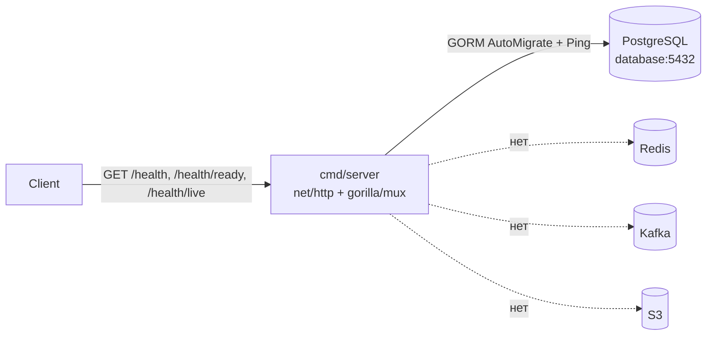
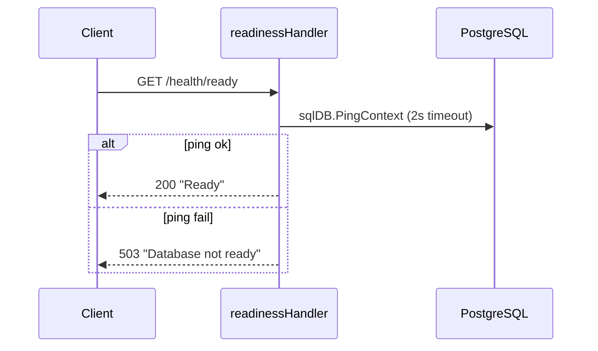
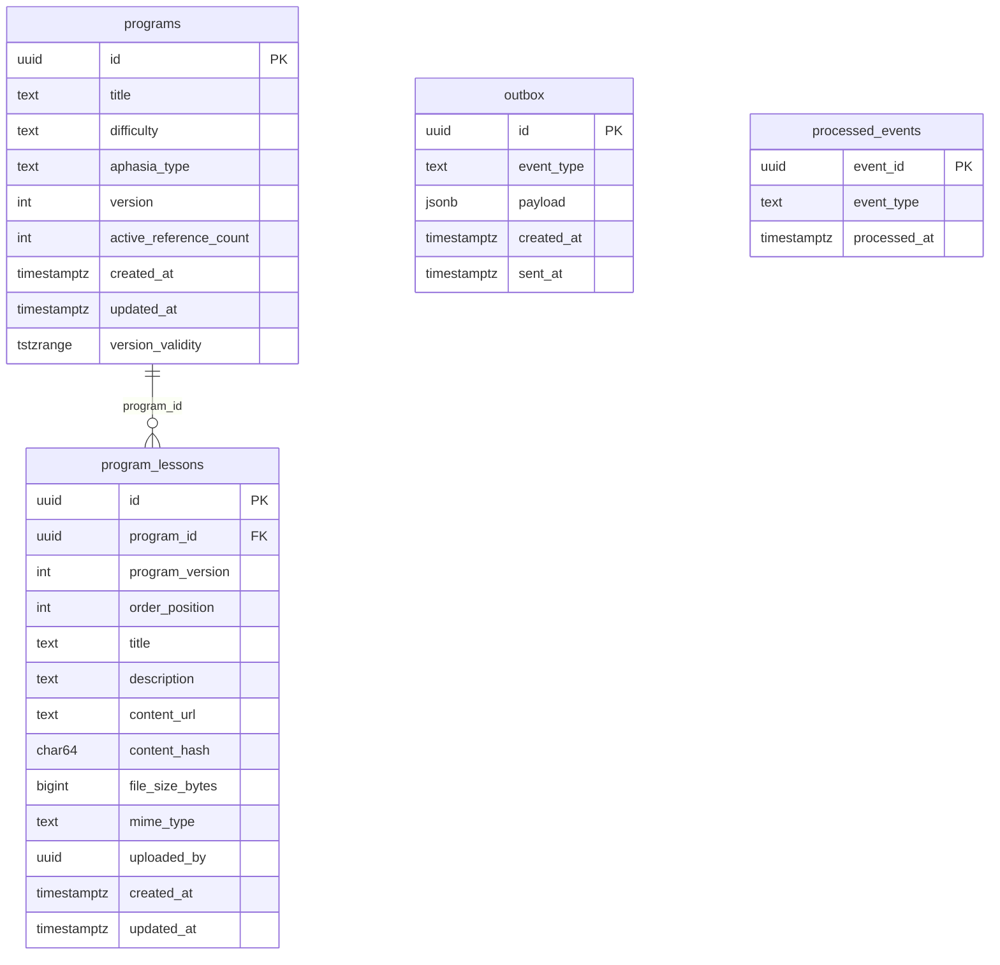

# rehabilitation-service — BC#3 Rehabilitation Content Management

Сервис управления реабилитационным контентом платформы SayMo (PWA реабилитации после инсульта).

- **BC:** BC#3 «Rehabilitation Content Management».
- **Источники истины:** `Reddetk/saymo-documentation` → `classifications/RehabilitationContentManagement.md`, `endpoints.md#bc3`, `events.md#bc3`, `EventDataFlow.md`, `Observability.md`, `adr/001`, `adr/004`, `adr-007`, `adr/008`, `deployment/*` (порядок при конфликте — как в `../AGENTS.md`).
- **Имя каталога/модуля:** постановка задачи называет сервис `rehabilitation-service`; `deployment/README.md` называет BC#3 `content-service`. Каталог и module path следуют постановке: `github.com/Reddetk/SayMoDev/rehabilitation-service`. HTTP-контракты, порты (8003, metrics 9003) и имена событий — из docs, без переименований.
- **Порт:** HTTP `8003`, Prometheus `/metrics` `9003` (`Observability.md`, таблица портов).
- **Стек:** Go 1.26, gin, pgx/v5, golang-migrate, Redis (go-redis), Kafka, AWS SDK v2 (S3/Yandex Object Storage), Prometheus, OpenTelemetry, zap (`log/slog` допускается только вне request-path; в проекте принят zap как в docs).

> Сгенерированный goca-код — основа, а не догма. Всё, что генератор не покрывает, помечено `// goca:manual — <причина>`; ручные правки не должны затираться повторной генерацией.

---

## План реализации (пайплайн AGENTS.md)

**Текущий шаг: S2 — домен Program/Lesson + миграции.** S1 закрыт 2026-11-25 (гейт PASS: build/vet/test + E2E + ревьюер). Измерено 2026-11-25: Go 1.26.0 (windows/amd64), Docker 29.9.3, Docker Compose v5.7.0, goca v1.27.0, swag v1.16.4; `task` и `golangci-lint` не установлены.

### AS-IS: измеренные цифры (2026-11-25, до S1)

| Метрика | AS-IS | Чем измерено |
|---|---|---|
| Каталог сервиса | создан `goca init --template enterprise --database postgres` (v1.27.0) | `goca init` |
| Go-файлов | 3 (`cmd/server/main.go`, `pkg/config`, `pkg/logger`) | `Get-ChildItem -Recurse -File` |
| HTTP-маршруты | 3: `/health`, `/health/ready`, `/health/live` | `cmd/server/main.go` |
| `/health` семантика | всегда `200`, статус `degraded` не меняет код ответа | `healthCheckHandler` |
| `/ready` | проверяет только PostgreSQL | `readinessHandler` |
| `/metrics` | 0 | нет обработчика и клиента Prometheus |
| Доменные таблицы | 0 | `migrations/001_initial.up.sql` — пустой шаблон |
| Миграции | 1 пара (пустая) + GORM `AutoMigrate` при старте | `main.go` |
| Docker compose | 2 сервиса (`rehabilitation-service`, `database`), без healthcheck у сервера, пароли в файле | `docker-compose.yml` |
| Redis / Kafka / S3 / Jaeger | 0 / 0 / 0 / 0 | compose |
| JWT-валидация / RBAC | 0 | нет middleware, `JWT_SECRET` в `.env.example` (неверная модель: BC#3 валидирует RS256 по JWKS) |
| Kafka-консьюмеры / outbox-publisher | 0 / 0 | нет кода |
| Тесты | 0 | `go test ./... -count=1` — `[no test files]` |
| `go build ./...`, `go vet ./...` | зелёные | локальный запуск |
| Покрытие | 0% | нет тестов |

### AS-IS: диаграмма (сгенерированный каркас)



Sequence AS-IS (`GET /health/ready`):



### AS-IS → TO-BE по шагам

| Шаг | Цель | AS-IS → TO-BE (цифры) | Docs / ADR |
|---|---|---|---|
| **S1** | Окружение, тестовый стенд, health-check каждой среды | compose 2 → 8 сервисов (postgres, redis-bc3, kafka, s3mock, s3init, jaeger, migrate, server); `/health`+`/ready`+`/metrics` 2 → 3 (метрики на :9003); миграции 1 пустая → 3 инфраструктурные пары; тесты 0 → 9 test-функций / 40 PASS-записей + 5 E2E; GORM AutoMigrate → golang-migrate; 3 env-файла | deployment/*, Observability.md |
| **S2** | Домен Program/Lesson + миграции | таблицы 0 → 2 (`programs`, `program_lessons`); миграции 3 → 8 пар (+3 индекса); инварианты: classifier unique/immutable, ≥1 lesson, order_position без дыр, лимит 200; unit-тестов 40 → ≥60 | classification BC#3 §1–4 |
| **S3** | JWT (RS256/JWKS) + RBAC + L1/L2 revocation | защищённых маршрутов 0 → 9; 401/403 ветки; JWKS-кэш TTL 1h, timeout 2s, fail-closed; RBAC `administrator` на write | classification §Authentication, ADR-003/004 |
| **S4** | Read API каталога | 0 → 3 GET (`/content/programs`, `/{id}?version`, `/{id}/lessons/{lessonId}`); L1 5min + L2 Redis 1h + singleflight; presigned URL TTL 1h / кэш 55min | endpoints.md#bc3, classification §HTTP |
| **S5** | Admin write API + S3 | 0 → 5 write-маршрутов (POST/PATCH/DELETE program, POST/PATCH/DELETE lesson); dedup SHA256; append не инкрементирует версию, insert_after_position инкрементирует; лимит 200 уроков; guard удаления через BC#4 | endpoints.md#bc3, classification §1–5 |
| **S6** | Kafka: outbox publisher + consumers | события 0 → 8 типов (`ProgramCreated`, `ProgramUpdated`, `ProgramDeleted`, `LessonAddedToProgram`, `LessonInsertedIntoProgram`, `LessonUpdated`, `LessonContentChanged`, `LessonRemovedFromProgram`); consumers 0 → 2 (`ProgramActivated`, `ProgramCompleted`), throttle 50 events/sec, idempotency TTL 7d | events.md#bc3, EventDataFlow T1/T2 |
| **S7** | Миграция пациентов | 0 → 1 endpoint `POST /admin/content/programs/{programId}/migrate-patients`; 202 + `migration_job_id`; rate limit 10/min | endpoints.md#bc3, classification |
| **S8** | Наблюдаемость, swagger, E2E | метрик 0 → семейства из Observability.md BC#3; `/metrics` :9003; `docs/` swagger; E2E по всем контрактам BC#3 | Observability.md |

Definition of done каждого шага: `go vet ./...`, `go build ./...`, `go test ./... -count=1 -race` зелёные, E2E зелёный, `docs/` swagger перегенерирован, этот план сдвинут, миграции парные.

---

## S1 — окружение и тестовый стенд (закрыт 2026-11-25)

### Подшаги S1

1. **S1.1 Конфигурация и fail-fast.** Единый `pkg/config`: env-only, обязательные переменные без дефолтов в `prod`, `.env.local` / `.env.test` / `.env.example` (`.env.prod` не коммитится). Конфиг валидируется на старте; при невалидном конфиге сервер не стартует.
2. **S1.2 Инфраструктура.** `docker-compose.yml`: postgres 16 (host 5435), redis-bc3 (6382), Kafka (KRaft, 9092), s3mock (9005/9006, S3-совместимый стенд для Yandex Object Storage), Jaeger (16686/4317), migrate (one-shot), server (8003/9003); shared `redis-blacklist` — через `REDIS_BLACKLIST_ADDR` (на этой машине 6383). Healthcheck у каждой зависимости, `depends_on: service_healthy`, сервер — после `migrate: service_completed_successfully`.
3. **S1.3 Миграции.** `cmd/migrate/main.go` (golang-migrate, флаги `-action up|down|force -version N`), пары `000001_create_outbox`, `000002_create_idx_outbox_unsent`, `000003_create_processed_events` с `BEGIN/COMMIT` и `DROP ... IF EXISTS`. GORM AutoMigrate удаляется.
4. **S1.4 Health / readiness / metrics.** `/health` (liveness, 200 всегда при живом процессе), `/ready` (200 только если PostgreSQL + Redis + Kafka writer + S3 bucket доступны; 503 + JSON со списком), `/metrics` на отдельном порту 9003 (Prometheus registry + `service_up`, `build_info`). Проверки с таймаутом 2s.
5. **S1.5 Базовый HTTP-сервер.** gin, graceful shutdown, request-id/trace, структурированный zap-лог, `X-Content-Type-Options`/`X-Frame-Options`, CORS до auth (для будущих шагов), раздельные admin/public группы (пока пустые).
6. **S1.6 Taskfile + Dockerfile.** `Taskfile.yml` с `infra:up/down`, `migrate:up/down/force`, `run`, `test:unit`, `test:integration`, `test:e2e`, `build`, `swagger`; `Dockerfile.server` (golang:1.26-alpine → distroless) и `Dockerfile` (образ migrate-бинарника).
7. **S1.7 TDD.** Фикстуры от чистого субагента (CSV: health/ready/metrics, границы env), красные тесты, затем реализация. E2E только через HTTP.

### TDD: фикстуры (от чистого субагента, без контекста)

Файлы: `testdata/fixtures/health.csv`, `testdata/fixtures/ready.csv`, `testdata/fixtures/config.csv`.
Покрываемые ветки: 200 (все зависимости живы), 503 (PostgreSQL недоступен / Redis недоступен / S3 недоступен), 405 (метод), 404 (путь), пустые/unicode/максимальные значения env, невалидный порт, отрицательные таймауты, отсутствующая обязательная переменная в prod. Каждая строка CSV имеет `case_id`, вход, ожидаемый HTTP-код и ожидаемый инвариант.

### Гейт S1 — закрыт

- [x] `go vet ./...`, `go build ./...`, `go test ./... -count=1 -race` — зелёные (лог: `BUILD=0 VET=0 TEST=0`)
- [x] `docker compose --env-file .env.local up -d` — postgres, redis-bc3, kafka `healthy`; s3init завершился, бакет создан
- [x] `GET :8003/health` → 200 `{"status":"ok",...}`; `GET :8003/ready` → 200 `{"status":"ready","checks":{"kafka":"ok","postgres":"ok","redis":"ok","s3":"ok"}}`; после `docker stop redis` → 503, после `start` → 200
- [x] `GET :9003/metrics` → 200, `service_up 1`, `build_info{commit="none",version="dev"} 1`
- [x] `go run ./cmd/migrate -action up|down` → `version=3 dirty=false` (up → down → up)
- [x] `POST :8003/health` → 405, `GET :8003/healthz` → 404
- [x] CORS: preflight `OPTIONS` с разрешённым Origin → 204 + `Access-Control-Allow-Origin` до JWT; неизвестный Origin заголовка не получает
- [x] `X-Request-ID` и `X-Trace-ID` (из W3C `traceparent` или сгенерированный) в ответе и в логах
- [x] swagger: `docs/docs.go`, `docs/swagger.json`, `docs/swagger.yaml`; `/swagger/index.html` в роутере; `go build/vet/test ./...` включают пакет `docs`
- [x] E2E (`go test -tags=e2e ./test/e2e/...`) — 5/5 PASS
- [x] субагент-ревьюер: три раунда, финальный вердикт PASS (docs-dependency, дедлайн Kafka-пробы, S1.5, compose/README)

Отклонения от docs, зафиксированные при закрытии S1:

1. **Локальный S3 — `adobe/s3mock` (пин по digest), не MinIO**: образы `minio/minio` и `minio/mc` недоступны из реестра на этой машине (`pull access denied`). Контракт S3 API (path-style, HeadBucket, presigned GET) тот же; в prod — Yandex Object Storage.
2. **Порт Redis — 6382, не 6381**: 6381 занят запущенным соседним `progress-service-redis-bc4` (BC#4). Конфликт портов, не контрактов.
3. **Shared `redis-blacklist` — 6383 на этой машине**: 6380 занят blacklist-инстансом BC#4. В S1 не используется; адрес вынесен в env.
4. **`go 1.26.0` в go.mod**: `go mod tidy` поднял директиву под фактический toolchain 1.26.0; `Dockerfile*` используют `golang:1.26-alpine` (docs говорят 1.25 — обновится вместе с docs/ADR при следующем шаге).
5. **OTel-экспорт (Jaeger :4317) — S8**: `JAEGER_OTLP_ENDPOINT` зарезервирован, но SDK не инициализируется. Корреляция S1 обеспечена `trace_id` из `traceparent`/генерацией, без экспортёра.

### S2 — домен и миграции (текущий шаг)

**Цель:** доменная модель BC#3 без HTTP/Kafka, миграции доменных таблиц, красные тесты из CSV чистого субагента.

Подшаги:

1. **S2.1 Value objects.** `Classifier` (difficulty, aphasia_type: non-empty, ≤50, immutable), `ProgramTitle` (non-empty, ≤200), `OrderPosition` (1..200), `ContentHash` (SHA-256, 64 hex в нижнем регистре), `ProgramVersion` (≥1). Sentinel-ошибки — в `internal/domain`.
2. **S2.2 Сущности.** `Lesson` (title, description, content_url, content_hash, file_size_bytes>0, mime_type=`application/pdf`, uploaded_by) и агрегат `Program` (id, title, classifier, version, lessons, active_reference_count).
3. **S2.3 Поведение агрегата.** `NewProgram` (≥1 урок, позиции 1..N без дыр/дублей), `AppendLesson` (версия не меняется), `InsertLessonAfter(K)` (K∈[1,N], версия+1, сдвиг K+1..N), `Rename` (классификатор не принимается), `IncrementRefCount`/`DecrementRefCount` (пол 0). Лимит 200 уроков.
4. **S2.4 Миграции.** `000004_create_programs`, `000005_create_program_lessons`, `000006_create_uniq_programs_classifier`, `000007_create_uniq_lessons_version_position`, `000008_create_idx_lessons_content_hash` — пары up/down, `BEGIN/COMMIT`.
5. **S2.5 Порты и pgx-адаптер.** `internal/port/out` с DTO, принадлежащими пакету порта (ADR-007: `ProgramRecord`, `CreateProgramCmd`), pgx-репозиторий с `SELECT ... FOR UPDATE` для вставки урока и удаления программы. Маппинг — внутри сервиса.
6. **S2.6 TDD.** CSV от чистого субагента: `testdata/fixtures/program.csv`, `lesson_ops.csv` (границы типов: пустое, unicode, 200/201 урок, позиции 0/-1/201, hash не 64 hex). Сначала красные тесты, затем реализация.

Гейт S2: `go vet/build/test -race` зелёные; `go test ./internal/domain/... -cover` ≥ 85%; миграции up/down/up; unit-тестов ≥60; ревьюер + E2E-агент (E2E S2 — миграции и отсутствие регрессии S1, HTTP-контрактов BC#3 ещё нет).


---

## TO-BE: модель данных BC#3 (S2, из docs)



Инварианты (дословно из `classifications/RehabilitationContentManagement.md`):

- `programs.(difficulty, aphasia_type)` — UNIQUE; classifier неизменяем после создания.
- Программа без уроков невозможна: создание программы и уроков — одна транзакция.
- Append урока версию не меняет; вставка между уроками — инкремент `version`, уроки `K+1..N` сдвигаются, старые пациенты остаются на старой версии.
- `order_position` 1-based, без дыр; удаление урока в рамках версии не «схлопывает» нумерацию; max 200 уроков.
- `content_hash` SHA256: одинаковый файл переиспользует `content_url` (S3 не вызывается повторно).
- Удаление программы/урока блокируется, пока у BC#4 есть активные пациенты на этой версии.

### TO-BE sequence: вставка урока (S5)

```mermaid
sequenceDiagram
    autonumber
    participant A as Admin
    participant H as POST /content/programs/:id/lessons
    participant CB as S3 circuit breaker
    participant DB as PostgreSQL
    participant O as outbox
    A->>H: multipart pdf_file + insert_after_position=K
    H->>H: JWT RS256 + role=administrator
    H->>H: SHA256(pdf), проверка dedup по content_hash
    H->>CB: PutObject (только при miss, вне транзакции)
    H->>DB: BEGIN; SELECT program FOR UPDATE
    H->>DB: INSERT new version: копия уроков K+1..N со сдвигом
    H->>O: LessonInsertedIntoProgram {oldVersion,newVersion,...}
    H->>DB: COMMIT
    H-->>A: 201 {lessonId,newVersion,orderPosition,contentUrl}
```

---

## Контрактные конфликты docs (зафиксированы, решение — в шаге)

| # | Конфликт | Решение | Шаг |
|---|---|---|---|
| 1 | `classifications` §3: счётчик `active_reference_count` локально + FOR UPDATE; `endpoints.md`: guard удаления — **синхронный REST к BC#4**, «НЕ локальный счётчик» | Контракт `endpoints.md` выигрывает: перед DELETE — `GET /admin/progress/program/{id}/version/{v}/active-patients`; локальный счётчик из Kafka остаётся метрикой/индикатором, не источником истины для guard | S5 |
| 2 | `classifications` §4: «Deleting lesson: NOT supported»; `endpoints.md` + `events.md`: `DELETE .../lessons/{lessonId}` и `LessonRemovedFromProgram` | Реализуем DELETE по контракту с guard BC#4; запрет из §4 трактуем как запрет «схлопывания» нумерации, а не как отсутствие endpoint | S5 |
| 3 | Token Validation Flow требует L3 PostgreSQL (`jwt_blacklist`, `accounts.rev`), но BC#3 не владеет БД BC#1 и прямые SQL-соединения запрещены (`context-map.md`) | L1 → L2 (shared `redis-blacklist`); при недоступности L2 — fail-closed 401. Кросс-BC SQL не делаем. Требуется ADR на L3 (или BC#1 internal endpoint) | S3 |
| 4 | `deployment/*` описывает layout `core/adapter/port`, goca даёт `internal/{domain,usecase,repository,handler}` | Каталоги goca (AGENTS.md, GOCA-first), DTO на границах — в пакетах-владельцах портов (ADR-007 по смыслу: handler/port DTO не тянет домен) | S2+ |

## Инструменты и команды

`task` не установлен; прямые эквиваленты (PowerShell, из каталога сервиса):

```powershell
docker compose --env-file .env.local up -d
go run ./cmd/migrate/main.go -action up
go run ./cmd/server/main.go
go test ./... -count=1 -race
swag init -g ./cmd/server/main.go -o ./docs --parseDependency --parseInternal
```

Порты стенда: server 8003, metrics 9003, postgres **5435**, redis-bc3 **6382**, kafka 9092, s3mock 9005/9006, jaeger 16686/4317. Shared `redis-blacklist` на этой машине — **6383** (6380 занят BC#4; владелец — identy-service).
